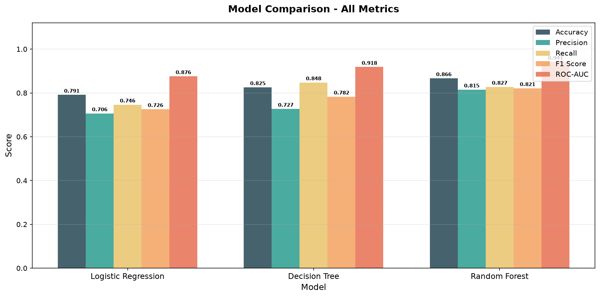
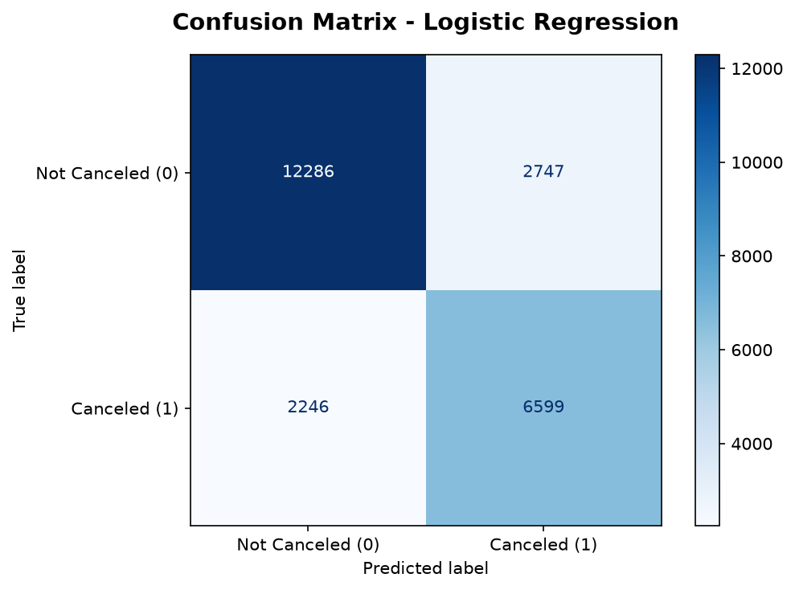
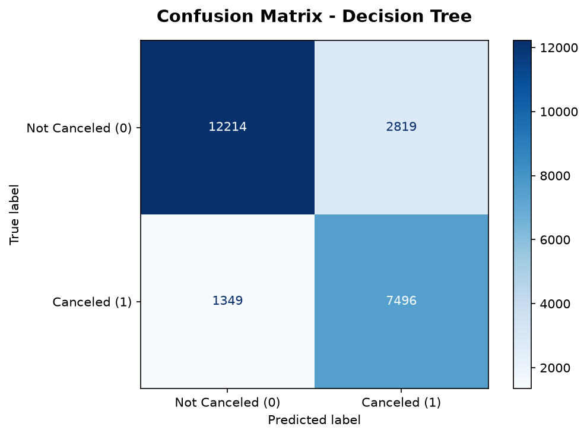
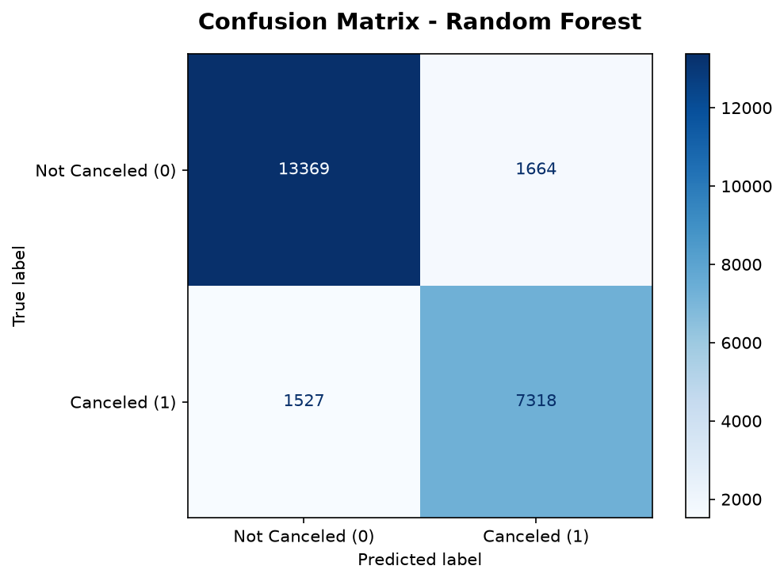
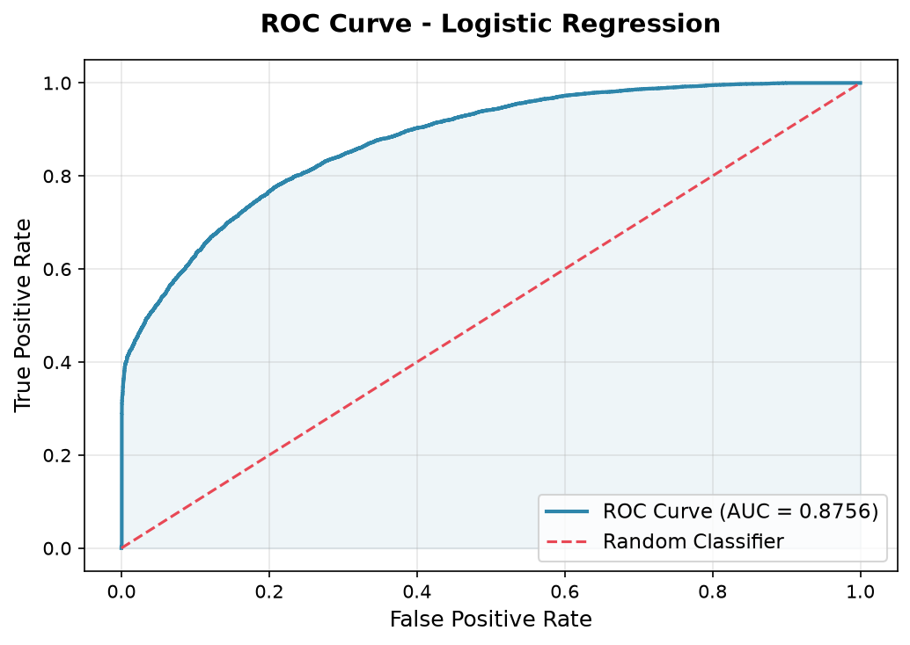
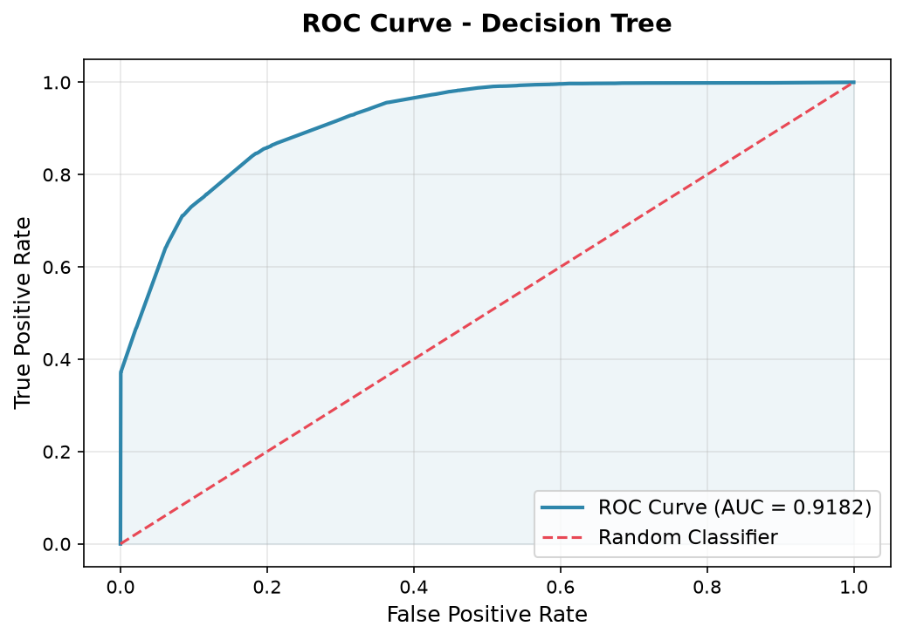
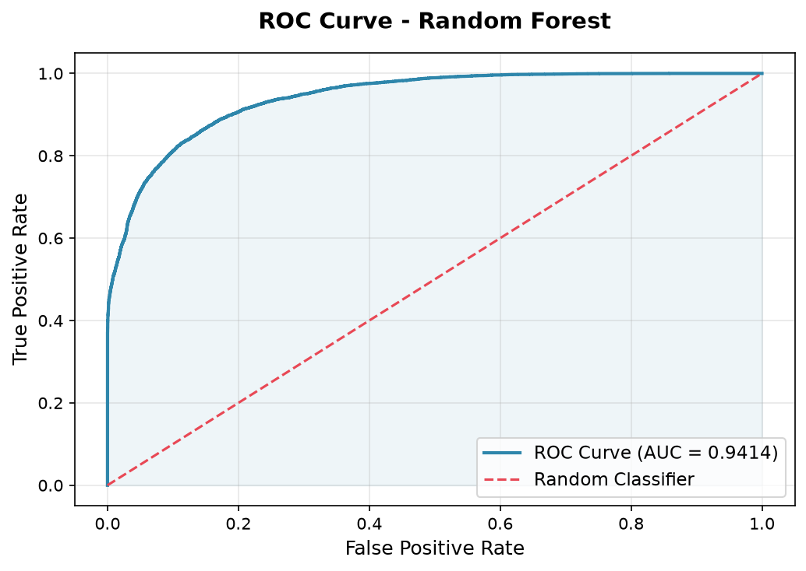
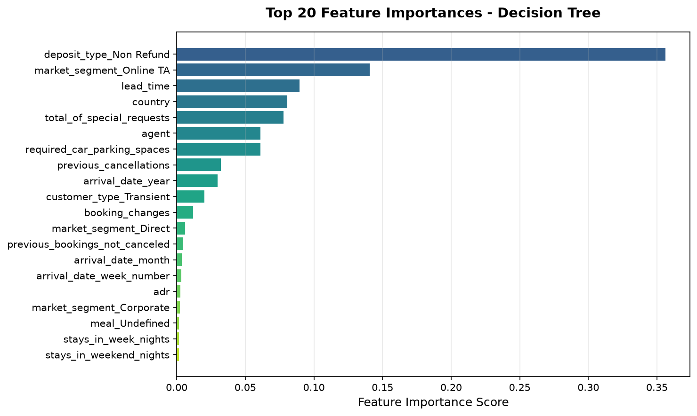
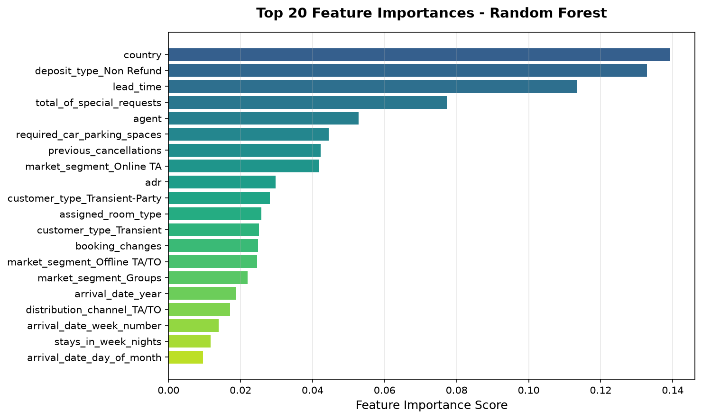

# MLflow Experiment Tracking — Hotel Booking Cancellation Prediction

> **MLOps Assignment 2 | Semester 5**  
> **Author:** Vidal Deo  
> **Date:** 29 July 2026  
> **Python:** 3.13 | **MLflow:** 3.14.0 | **scikit-learn:** 1.9.0

---

## Table of Contents

1. [Project Overview](#project-overview)
2. [Dataset](#dataset)
3. [Project Structure](#project-structure)
4. [Installation](#installation)
5. [How to Run](#how-to-run)
6. [Preprocessing Pipeline](#preprocessing-pipeline)
7. [Models Trained](#models-trained)
8. [Results](#results)
9. [Visualizations](#visualizations)
10. [MLflow Experiment Tracking](#mlflow-experiment-tracking)
11. [MLflow Commands](#mlflow-commands)
12. [Screenshots](#screenshots)
13. [Future Scope](#future-scope)

---

## Project Overview

This project implements a **production-quality end-to-end Machine Learning pipeline** as part of a college **MLOps (Machine Learning & AI Operations)** assignment. The goal is to predict whether a hotel booking will be **cancelled or not** using the Hotel Booking Demand dataset, while demonstrating professional experiment tracking using **MLflow**.

### Key Features

- ✅ Automated data loading with error handling and encoding fallback
- ✅ Full preprocessing pipeline — imputation, label encoding, one-hot encoding, standard scaling
- ✅ Stratified 80/20 train-test split
- ✅ Three ML models trained and evaluated: **Logistic Regression**, **Decision Tree**, **Random Forest**
- ✅ Comprehensive metrics: Accuracy, Precision, Recall, F1 Score, ROC-AUC
- ✅ Complete MLflow tracking — parameters, metrics, artifacts, and trained models per run
- ✅ Automatic best-model selection based on Accuracy + F1 Score
- ✅ Best model registered in **MLflow Model Registry**
- ✅ Professional visualizations: Confusion Matrix, ROC Curve, Feature Importance

---

## Dataset

| Property | Value |
|---|---|
| **Name** | Hotel Booking Demand |
| **File** | `hotel_bookings.csv` |
| **Rows** | 119,390 |
| **Columns** | 36 |
| **Target Column** | `is_canceled` (0 = Not Cancelled, 1 = Cancelled) |
| **Class Distribution** | 75,166 Not Cancelled / 44,224 Cancelled |
| **Missing Values** | 4 columns (company 94.3%, agent 13.7%, country 0.41%, children ~0%) |
| **Source** | [Kaggle — Hotel Booking Demand](https://www.kaggle.com/datasets/jessemostipak/hotel-booking-demand) |

---

## Project Structure

```
MLflow_Assignment/
│
├── data/
│   └── hotel_bookings.csv          ← Dataset (not committed — too large)
│
├── src/
│   └── train.py                    ← Main training script (1,297 lines)
│
├── artifacts/
│   ├── confusion_matrix_*.png      ← Confusion matrix for each model
│   ├── roc_curve_*.png             ← ROC curve for each model
│   ├── feature_importance_*.png    ← Feature importance (tree models)
│   ├── classification_report_*.txt ← Text classification reports
│   └── model_comparison.png        ← Side-by-side comparison chart
│
├── screenshots/
│   └── *.png                       ← All 17 assignment screenshots
│
├── models/
│   └── best_model_*.joblib         ← Saved best model (local fallback)
│
├── mlruns/                         ← MLflow auto-generated tracking data
│
├── mlflow.db                       ← SQLite tracking backend (auto-generated)
│
├── requirements.txt                ← Python dependencies
├── .gitignore                      ← Git exclusions
└── README.md                       ← This file
```

---

## Installation

### Prerequisites
- Python 3.13
- Git
- Windows OS
- VS Code (recommended)

### Step 1 — Clone the Repository

```bash
git clone https://github.com/FuricBond/MLflow_Hotel_Booking_Cancellation.git
cd MLflow_Hotel_Booking_Cancellation
```

### Step 2 — Create Virtual Environment

```powershell
python -m venv .venv
```

### Step 3 — Activate Virtual Environment

```powershell
.venv\Scripts\activate
```

You will see `(.venv)` in your terminal prompt.

### Step 4 — Install Dependencies

```powershell
pip install -r requirements.txt
```

### Step 5 — Add the Dataset

Download `hotel_bookings.csv` from [Kaggle](https://www.kaggle.com/datasets/jessemostipak/hotel-booking-demand) and place it at:

```
MLflow_Assignment/data/hotel_bookings.csv
```

---

## How to Run

```powershell
python src\train.py
```

The script automatically:
1. Loads and validates the dataset
2. Analyses missing values and data quality
3. Performs the full preprocessing pipeline
4. Splits data 80/20 with stratification
5. Trains three ML models
6. Evaluates and logs everything to MLflow
7. Compares models and identifies the best performer
8. Registers the best model in the MLflow Model Registry
9. Saves all plots to `artifacts/`

> The script **pauses at each milestone** and prompts you to take a screenshot before continuing.

---

## Preprocessing Pipeline

| Step | Method | Details |
|---|---|---|
| Drop Leakage Columns | Manual | `reservation_status`, `reservation_status_date` |
| Remove Duplicates | `df.drop_duplicates()` | 0 duplicates found |
| Missing Value Imputation | `median` / `mode` | Numeric → median, Categorical → mode |
| Label Encoding | `LabelEncoder` | Binary + high-cardinality columns (>10 unique) |
| One-Hot Encoding | `pd.get_dummies()` | Low-cardinality columns (3–10 unique values) |
| Feature Scaling | `StandardScaler` | Applied to all 56 numeric features |

**Final Feature Matrix:** 119,390 rows × 56 columns

**Label-Encoded:** `hotel`, `arrival_date_month`, `country`, `assigned_room_type`, `name`, `email`, `phone-number`, `credit_card`

**One-Hot-Encoded:** `meal`, `market_segment`, `distribution_channel`, `reserved_room_type`, `deposit_type`, `customer_type`

---

## Models Trained

### 1. Logistic Regression
| Hyperparameter | Value |
|---|---|
| C (Regularization) | 1.0 |
| Solver | lbfgs |
| Max Iterations | 1000 |
| Class Weight | balanced |

### 2. Decision Tree Classifier
| Hyperparameter | Value |
|---|---|
| Max Depth | 10 |
| Min Samples Split | 20 |
| Min Samples Leaf | 10 |
| Criterion | gini |
| Class Weight | balanced |

### 3. Random Forest Classifier
| Hyperparameter | Value |
|---|---|
| N Estimators | 100 |
| Max Depth | 15 |
| Min Samples Split | 10 |
| Min Samples Leaf | 5 |
| Max Features | sqrt |
| Criterion | gini |
| Class Weight | balanced |

---

## Results

### Model Comparison

| Model | Accuracy | Precision | Recall | F1 Score | ROC-AUC |
|---|---|---|---|---|---|
| Logistic Regression | 0.7909 | 0.7061 | 0.7461 | 0.7255 | 0.8756 |
| Decision Tree | 0.8254 | 0.7267 | 0.8475 | 0.7825 | 0.9182 |
| 🏆 **Random Forest** | **0.8664** | **0.8147** | **0.8274** | **0.8210** | **0.9414** |

### Best Model: Random Forest

```
Best Model      : Random Forest
Best Accuracy   : 0.8664  (86.64%)
Best Precision  : 0.8147  (81.47%)
Best Recall     : 0.8274  (82.74%)
Best F1 Score   : 0.8210  (82.10%)
Best ROC-AUC    : 0.9414  (94.14%)
MLflow Run ID   : c9ae6c05e3414931b11e1153f0844844
Registry Name   : HotelBookingCancellation_BestModel (Version 1)
```

### Split Information

```
Train Set : 95,512 rows (80%)
Test Set  :  23,878 rows (20%)
Strategy  : Stratified split (class-balanced)
```

---

## Visualizations

All plots are saved in the `artifacts/` folder and logged to MLflow.

### Model Comparison Chart



---

### Confusion Matrices

| Logistic Regression | Decision Tree | Random Forest |
|---|---|---|
|  |  |  |

---

### ROC Curves

| Logistic Regression | Decision Tree | Random Forest |
|---|---|---|
|  |  |  |

---

### Feature Importance (Tree-Based Models)

| Decision Tree | Random Forest |
|---|---|
|  |  |

---

## MLflow Experiment Tracking

### Experiment Details

| Property | Value |
|---|---|
| **Experiment Name** | Hotel Booking Cancellation Experiment |
| **Experiment ID** | 1 |
| **Tracking Backend** | SQLite (`mlflow.db`) |
| **Tracking URI** | `sqlite:///mlflow.db` |

### What is Logged Per Run

| Category | Items Logged |
|---|---|
| **Parameters** | All model hyperparameters |
| **Metrics** | Accuracy, Precision, Recall, F1 Score, ROC-AUC |
| **Artifacts → plots/** | Confusion matrix, ROC curve, Feature importance |
| **Artifacts → reports/** | Full classification report (text file) |
| **Model** | Serialized sklearn model with input/output signature |

### Registered Model

```
Registry Name : HotelBookingCancellation_BestModel
Model         : Random Forest Classifier
Version       : 1
Run ID        : c9ae6c05e3414931b11e1153f0844844
```

---

## MLflow Commands

### Launch MLflow UI

```powershell
# Run inside MLflow_Assignment/ folder with venv activated
mlflow ui --backend-store-uri sqlite:///mlflow.db
```

Then open: **http://127.0.0.1:5000**

### List All Experiments

```powershell
mlflow experiments list
```

### List All Runs in an Experiment

```powershell
mlflow runs list --experiment-name "Hotel Booking Cancellation Experiment"
```

### Load the Registered Best Model (Python)

```python
import mlflow.sklearn

model = mlflow.sklearn.load_model(
    "models:/HotelBookingCancellation_BestModel/1"
)
predictions = model.predict(X_test)
```

---

## Screenshots

All screenshots captured during the assignment run on 29 July 2026.

---

### Screenshot 1 — Project Folder Structure in VS Code


---

### Screenshot 2 — Virtual Environment Activated


---

### Screenshot 3 — Required Libraries Successfully Installed


---

### Screenshot 4 — Dataset Successfully Loaded
> Shape: 119,390 rows × 36 columns | First 5 rows | Column data types


---

### Screenshot 5 — Missing Values Analysis
> Total duplicates: 0 | Total missing: 129,425 | 4 affected columns


---

### Screenshot 6 — Preprocessing Completed
> Encoding completed | Scaling applied | Final shape: (119,390, 56)


---

### Screenshot 7 — Training and Testing Split
> X_train: (95,512, 56) | X_test: (23,878, 56) | Stratified 80:20


---

### Screenshot 8 — Logistic Regression Training Completed
> Accuracy: 0.7909 | F1: 0.7255 | ROC-AUC: 0.8756


---

### Screenshot 9 — Decision Tree Training Completed
> Accuracy: 0.8254 | F1: 0.7825 | ROC-AUC: 0.9182


---

### Screenshot 10 — Random Forest Training Completed
> Accuracy: 0.8664 | F1: 0.8210 | ROC-AUC: 0.9414


---

### Screenshot 11 — Model Comparison Table
> Best Model: Random Forest | Highest Accuracy and F1 Score


---

### Screenshot 12 — Confusion Matrix (Best Model — Random Forest)


---

### Screenshot 13 — ROC Curve (Best Model — Random Forest)
> AUC = 0.9414


---

### Screenshot 14 — MLflow UI Home Page
> Experiment: Hotel Booking Cancellation Experiment | All 3 runs visible


---

### Screenshot 15 — MLflow Run Details
> Parameters, Metrics, Artifacts, and Logged Model for a single run


---

### Screenshot 16 — Registered Best Model in MLflow Model Registry
> HotelBookingCancellation_BestModel | Version 1 | Random Forest


---

### Screenshot 17 — Final Project Folder Structure
> Completed project with all generated files and directories


---

### Screenshot 18 — MLflow UI — Model Registry Page


---

## Future Scope

| Enhancement | Description |
|---|---|
| **Hyperparameter Tuning** | Use `GridSearchCV` or `Optuna` for automated tuning |
| **Cross-Validation** | Add k-fold CV for more robust evaluation |
| **Additional Models** | XGBoost, LightGBM, SVM for comparison |
| **Feature Engineering** | Extract features from booking date columns |
| **SHAP Explainability** | Add SHAP values for model interpretability |
| **CI/CD Pipeline** | GitHub Actions for automated retraining on new data |
| **Model Serving** | Deploy best model via MLflow's REST API server |
| **Docker** | Containerise the project for reproducibility |
| **Remote MLflow** | Connect to AWS/GCP/Azure MLflow tracking server |
| **Data Drift Detection** | Monitor production data with Evidently AI |

---

## Dependencies

```
mlflow          3.14.0
scikit-learn    1.9.0
pandas          2.3.3
numpy           2.5.1
matplotlib      3.11.1
seaborn         0.13.2
joblib          1.5.3
scipy           1.18.0
tabulate        0.10.0
tqdm            4.70.0
```

---

## License

This project is created for educational purposes as part of a college MLOps assignment (Semester 5, Assignment 2).

---

*Made with ❤️ by Vidal Deo | MLOps Assignment 2 | 2026*
